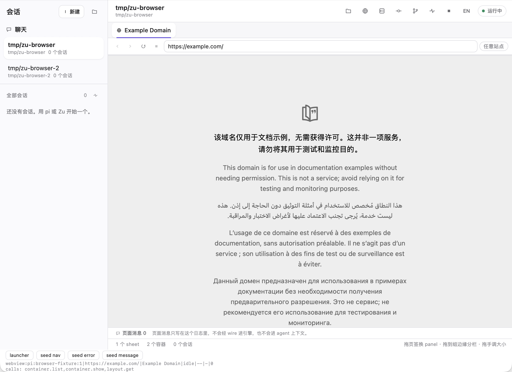
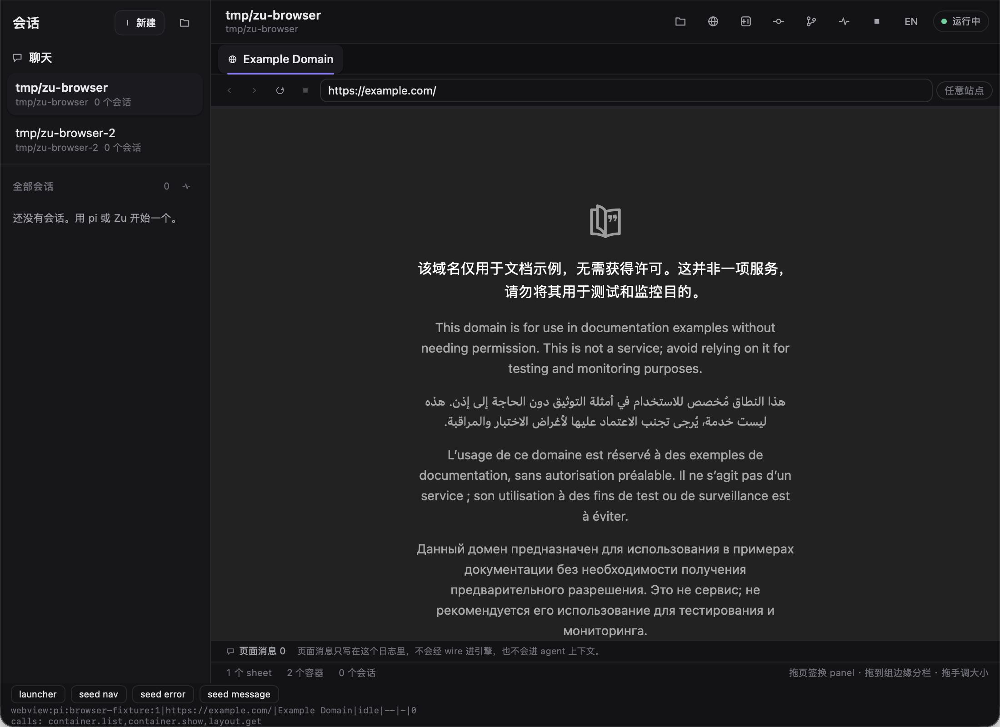
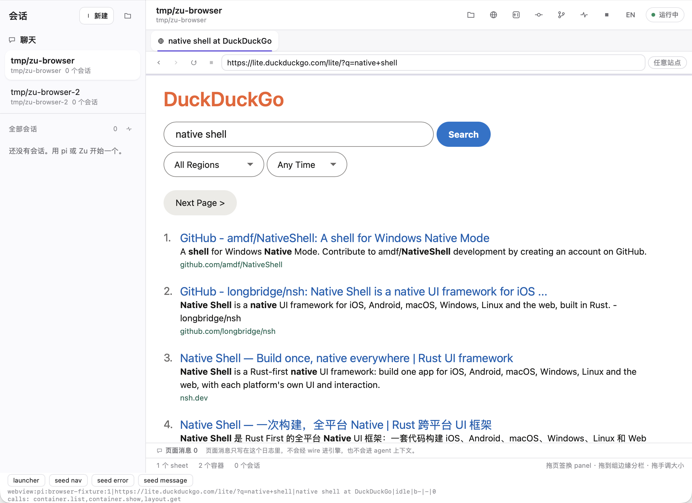
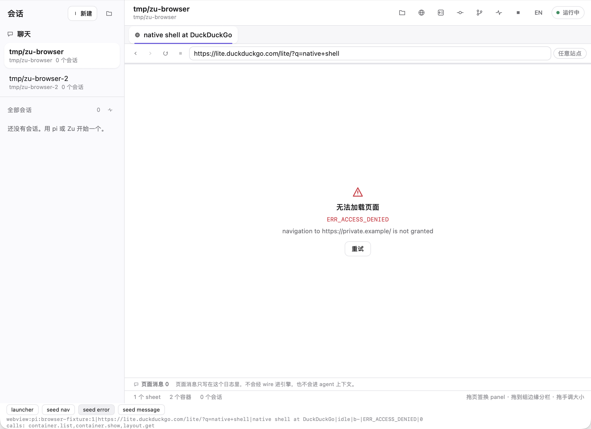
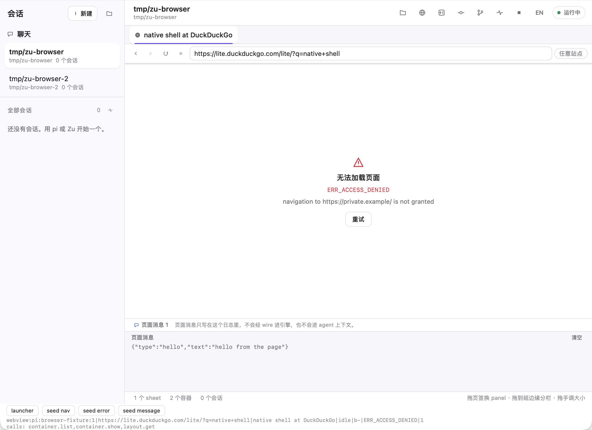

# M10 浏览器：实现与验收证据

> 2026-11-11。M10 在真实 macOS 宿主上加载了真实网页；headless 宿主没有 web view，
> 只验证 UI 状态机与地址解析。本文只记录实际跑过的命令与看到的结果。

## 1. 结论

| 验收项 | 结果 |
|---|---|
| Browser sheet：一个 `WebView` + 地址栏 + 后退/前进/刷新/停止 | ✓ 实现；真实页面上后退/前进走 WebKit 自身历史 |
| 每 sheet 一个 web view；每容器多个（`webview:{containerId}:{n}`） | ✓ headless UI 测试开两个 sheet |
| 标题/URL/loading/error 在 UI store；切容器/隐藏后保留 URL 与标题 | ✓ headless：隐藏后地址恢复为 `https://example.com/` |
| 地址栏：裸域名补 `https://`；只开 http/https | ✓ 纯测试覆盖 18 组输入 |
| 页面标题进页签 | ✓ 真实页面：`Example Domain`、`Example Domains`、`native shell at DuckDuckGo` |
| 错误码（`ERR_ACCESS_DENIED` / `ERR_FEATURE_UNAVAILABLE_ON_PLATFORM`） | ✓ UI 走同一 reducer；真实拒绝无法在本 app 内制造（§5） |
| 默认页：任何站点可加载、页面消息不进 agent | ✓ 文案 + `webview.hosts: ["*"]` 标记 |
| 打开入口：Launcher「浏览器」/ 顶栏 `open-browser` | ✓ UI 测试从 Launcher 打开第一个，顶栏 `open-browser` 打开第二个 |
| 页面消息只进 UI 日志 | ✓ `onMessage` → store；UI 测试证明 transport 调用不变；无 `injectJavaScript` 代码 |
| 非可见 sheet 降级 | ✓ nsh 无 pause prop；不可见时卸载 `WebView`，显示时按 store 的 URL 重挂载 |
| 打开文档页、搜索、前进后退 | ✓ 真实页面全部跑通（§4） |
| 链接在 sheet 内或外部打开 | 部分：普通链接在 sheet 内导航（WebView 顶层导航）；`target=_blank`/`window.open` **不会**被 nsh 0.4.0 打开，见 §6 |

**headless 能否显示 WebView（一次性探针，跑完已删除文件）**：`fixtures/webview-probe.tsx` 挂一个
`html` 页（`<title>Probe Title</title>`、一个链接、一个 `window.nsh.postMessage` 按钮），把
`onLoadStart`/`onLoad`/`onNavigationStateChange`/`onMessage`/`onError` 写进一行状态：

- headless：1.5 s 后状态仍为 `none`，没有任何页面事件；`WebView.available()` 仍返回 `true`
  （平台声明可显示，但 headless 宿主没有页面）。
- `--target macos`：同一 fixture 收到 `onNavigationStateChange`（`nav::false`）。
因此 headless 只画 WebView 的结构，不加载页面；保留下来的 `browser.ui.test.tsx` 不等待真实
nav 事件，真实页面只由 `browser.live.test.tsx --target macos` 覆盖。

## 2. 门禁（实际输出）

在仓库根目录、独立端口/状态目录下运行，未触碰运行中的用户 app：

```sh
nsh check .                                   # ✓ checked zu-app
nsh build .                                   # ✓ App.tsx into .nsh/out
cargo check --all-targets                     # ✓ Finished dev profile
cargo test --lib                              # ✓ 29 passed; 0 failed
ZU_PORT=47834 ZU_STATE_DIR=/tmp/zu-m10-test-$$ nsh test .   # ✓ 130 tests: 130 passed, 0 failed
```

`nsh build` 写出的 `.nsh/out/capabilities.json`：

```json
{"network":{"hosts":["127.0.0.1"],"http":[]},"process":{"execute":[],"exit":false,"env":["ZU_PORT","ZU_STATE_DIR"]},
 "fs":{"read":[],"write":[]},"webview":{"hosts":["*"]},"statusBar":true,"clipboard":false,"picker":false,"openUrl":false}
```

即：只增加 `webview.hosts: ["*"]`（Q32），没有 `webview.input`、`openUrl`、`fs` 或 `process.execute`。

新增/变化的测试计数：基线 122 → 130（+3 条 `browser.test.ts`、+3 条 `browser.ui.test.tsx`、
+1 条 `browser.live.test.tsx`、+1 条 Rust 能力声明测试）。没有弱化既有测试。

## 3. 真实 macOS 宿主

```sh
nsh test browser.live.test.tsx --target macos
# ✓ browser.live.test.tsx › the browser sheet loads a real page, a document page and a search, and walks history (13.6s)
# ✓ 1 test: 1 passed, 0 failed
```

它不是一个绕过默认门禁的脚本：`nsh test .` 也会在 headless 下运行它；headless 没有可截图的
窗口，测试断言默认页后返回（`WebView.available()` 在 headless 仍为 `true`，但不会加载页面）。
真实目标由 `app.screenshot()` 是否可用来区分——只在 `--target` 下继续。

真实加载序列（地址栏输入 → store 的最终状态）：

| # | 输入 | 最终 URL | 页签标题 |
|---|---|---|---|
| 1 | `example.com` | `https://example.com/` | `Example Domain` |
| 2 | `https://www.iana.org/help/example-domains` | 同输入 | `Example Domains` |
| 3 | `https://lite.duckduckgo.com/lite/?q=native+shell` | 同输入 | `native shell at DuckDuckGo` |
| 后退 | — | `https://www.iana.org/help/example-domains` | `Example Domains` |
| 前进 | — | `https://lite.duckduckgo.com/lite/?q=native+shell` | `native shell at DuckDuckGo` |

`browser-back` / `browser-forward` 的 enabled 状态也由测试断言：新标签页时两者 disabled；
加载后 back 可用、forward 不可用；后退后 forward 可用。按下按钮确实改变了页面（标题回到
`Example Domains`，再前进回 `DuckDuckGo`），不是只改 UI。

截图（2200×1600，2×）：

- 
- 
- 
- 
- 

## 4. 搜索与文档页

- 文档页：`https://www.iana.org/help/example-domains`，页签 `Example Domains`，页面真实渲染。
- 搜索：地址栏输入 `https://lite.duckduckgo.com/lite/?q=native+shell`，页签
  `native shell at DuckDuckGo`，结果列表真实渲染（截图中可见 GitHub / nsh.dev 等结果）。
  这里**没有**往页面搜索框里打字（headless/真实测试都没有 `webview.input` 授权，也没有
  `sendInput` 调用）；搜索是通过搜索结果 URL 完成的。
- 更早一次尝试用 Wikipedia 的搜索结果页，页面一直 `loading` 超时（该页面太重/资源未完成），
  因此证据改用 DuckDuckGo Lite；这属于站点加载差异，不是 sheet 的失败。

## 5. 能力与负向行为

`nsh.json` 的 `webview.hosts: ["*"]` 是 Q32 的显式授权；UI 在地址栏右侧显示「任意站点」，
并在默认页/日志脚注写明「页面消息只留在这个面板，永远不会进入 agent」。

**未授权的 webview 无法在本 app 内演练**：nsh 的 `capabilities` 是 app 级声明，同一份
`nsh.json` 不能同时有和没有 `webview`；要制造真实拒绝，需要另建一个不带该键的临时 app。
因此：

- `src/lib.rs` 的 Rust 测试直接读 `nsh.json`，断言 `webview.hosts == ["*"]`、没有
  `webview.input`、没有 `openUrl`、没有 `fs`/`process.execute`；
- `browser.ui.test.tsx` 用 `reportBrowserError`（与 `WebView` 的 `onError` 同一个 reducer）
  喂入 `ERR_ACCESS_DENIED`，断言错误面板显示码与重试按钮；
- `WebView.available()` 为 false 的平台走同一个面板，码为
  `ERR_FEATURE_UNAVAILABLE_ON_PLATFORM`（UI 代码路径）。

没有把「模拟错误」说成「真实拒绝」：真实拒绝需要独立 app，未做。

## 6. 链接与外开

- 普通链接：WebView 的顶层导航在 sheet 内完成；`webview.hosts: ["*"]` 允许任意 http/https
  顶层导航（平台导航委托逐次检查）。
- `target=_blank` / `window.open`：nsh 0.4.0 的 WKWebView 没有 `createWebViewWithConfiguration`
  处理，页面请求的新窗口不会打开；nsh 也没有向 app 暴露「链接目标 / 新窗口」回调。
- 因此 **没有** 授予 `openUrl`：没有可路由的外部打开事件，授予它只会扩大能力面。
  若后续 nsh 提供外开/新窗口回调，再按需加 `openUrl.schemes: ["http","https"]`，并只在该
  回调里调用 `openUrl`。
- 限制：当前 `target=_blank` 链接点击后无反应（不是被外部打开）。这是 M10 的已知缺口，
  不是「已支持外部打开」。

## 7. 非可见 sheet 与页面消息隔离

- nsh 的 `WebViewProps` **没有** pause/暂停 prop（`.nsh/types/nsh/types.d.ts` 的
  `WebViewHostProps` 只有 src/html/baseUrl/injectedJavaScript/userAgent/scrollable/
  javaScriptEnabled/incognito/on*）。所以实现是：`BrowserBody` 读
  `visiblePanels()`，不可见时整块卸载 `WebView`；再次可见时用 store 里的 `url` 重新挂载。
- 保留：URL、标题、loading/error、消息日志（都在 `browser.ts` 的 store）。
  丢失：页面运行时状态——滚动位置、表单、SPA 内存、页面内 history。这已在
  `browser-ui.tsx` 顶部与 architecture §4.3 写明，不声称有 pause API。
- headless 证据：`browser.ui.test.tsx` 打开第二个 browser sheet 后，第一个的 `WebView` 卸载
  （同一时刻只有一个 `browser-address`），再切回时输入框恢复为 `https://example.com/`。
- 应用重启：布局 stash 会恢复 `webview:{containerId}:{n}` 这个页签 id，但 store 是内存态，
  所以重启后是一个新标签页（没有 URL/标题）。这与 §5.5「webview 页面不跨重启」一致。
- 页面消息：`onMessage` 只调用 `logBrowserMessage`；`browser.ts` 不 import engine/wire，
  也没有任何 `request`/`send` 调用。UI 测试在 `seed-message` 前后断言 `fixture-calls`
  的 transport 调用列表完全相同。`injectJavaScript`/`injectedJavaScript` 在实现里
  **完全没用**（只在注释里出现），页面消息不会以任何形式进入 wire 或 agent 上下文。

## 8. 未覆盖 / 限制（诚实）

1. headless 宿主没有 web view：`WebView.available()` 返回 true，但页面不加载、无导航事件。
   默认 `nsh test .` 里的 `browser.live.test.tsx` 只验证默认页后返回，**不是**真实页面证据；
   真实证据只来自 `--target macos`。
2. `target=_blank`/`window.open` 不打开（§6），没有 `openUrl` 外开。
3. 搜索是通过搜索结果 URL 完成的，没有验证「在页面搜索框里打字」（没有 `webview.input`）。
4. 页面内链接没有自动化点击（测试驱动没有页内坐标点击），只验证了地址栏导航与
   浏览器历史；普通链接在 sheet 内导航是 WebView 的平台行为，未单独截图。
5. 深色模式下，依赖 `color-scheme` 的页面（如 `example.com`）由页面自己画 `#222` 背景，
   但 nsh 0.4.0 的 WKWebView 在该截图中仍用默认黑色文字，导致对比度差。这是 web view
   上游行为，sheet 的 chrome（工具栏/页签/错误/日志）在深色下正常；见 dark 截图。
6. 页面消息日志上限 50 条、每条最多 4096 字符；超出丢最旧的/截断。
7. 未在 iOS/Android/Windows/Linux 上验证真实 web view。
